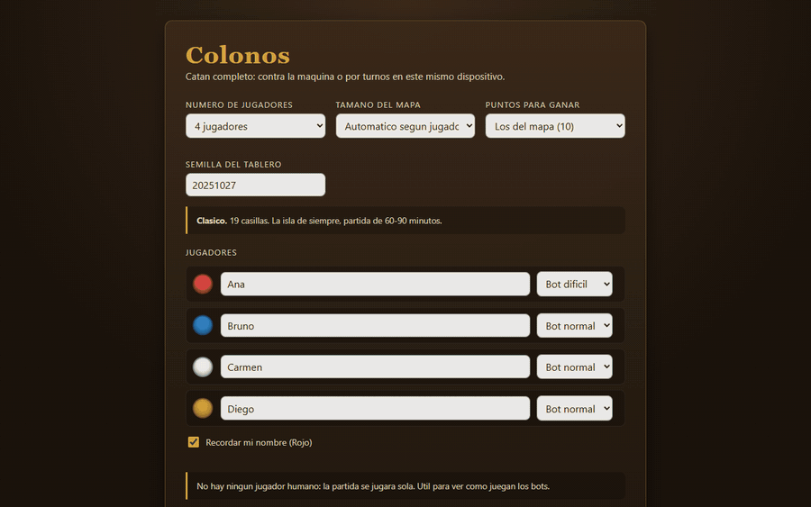

# Colonos — Catan digital

**Implementación completa del juego de mesa Catan en TypeScript**, con tablero 3D dibujado por código, bots con tres niveles de dificultad y partidas multijugador en red local con servidor autoritativo.

### ▶ [Jugar en el navegador](https://juanjhenao.github.io/catan-digital/)

Sin instalar nada: partida local contra bots o por turnos en el mismo dispositivo. El modo en red local necesita el servidor del repositorio (`npm run lan`).




---

## Funcionalidades

- **Reglas completas del juego base**: colocación en serpiente, producción, escasez del banco, el 7 con descarte y ladrón, las cinco cartas de desarrollo con sus restricciones, comercio marítimo 4:1 / 3:1 / 2:1, comercio entre jugadores, ruta más larga y mayor ejército con desempate.
- **Extensión de 5-6 jugadores**: tablero de 30 casillas, 11 puertos y mazo ampliado.
- **Multijugador en red local**: un equipo levanta el servidor, los demás entran desde el navegador con un código de sala de cuatro letras. Reconexión automática al mismo asiento.
- **Modo local por turnos** con escudo de privacidad entre jugadores.
- **Bots** fácil, normal y difícil que rellenan asientos vacíos.
- **Tablero 3D con cámara libre** (girar, zoom al cursor, desplazar), construcción pulsando el mapa con pieza fantasma, dados 3D, chat, reloj de jugada y sonido sintetizado.
- **Cero assets**: ni una imagen ni un archivo de audio. Todo se dibuja con canvas y SVG, y todo suena con Web Audio.

## Stack

| Capa | Tecnología |
|---|---|
| Lenguaje | TypeScript 5 (estricto), ES2022 |
| Build y dev server | Vite 5 |
| Render | Canvas 2D con proyección 3D propia, SVG |
| Audio | Web Audio API (osciladores y ruido filtrado) |
| Red | WebSocket (`ws`) sobre el mismo puerto HTTP que sirve el juego |
| Pruebas | Vitest, jsdom, node-canvas, fuzzing con `tsx` |

## Aspectos técnicos destacados

### 1. Motor de reglas puro y determinista
`src/engine/` no toca el DOM, no llama a `Math.random` ni mira el reloj. Su interfaz es la de un reductor:

```ts
const state  = createGame(players, { seed });      // partida determinista
const moves  = getLegalActions(state, playerId);   // todo lo que puede hacer
const result = applyAction(state, moves[0]);       // (estado, acción) -> estado
```

El azar vive dentro del estado (generador mulberry32 con semilla), así que una partida se reconstruye entera a partir de la semilla y la lista de acciones. Esa forma hizo que los bots y la red salieran casi gratis: un bot es una función que elige entre acciones legales, y el servidor revalida cada jugada con el mismo `validate()` que usa el cliente, sin lógica duplicada. → [`src/engine/`](src/engine)

### 2. Servidor autoritativo con censura del estado por jugador
Los clientes solo *proponen* jugadas. Antes de enviar el estado a cada jugador, el servidor le quita lo que no le corresponde ver: las manos ajenas, las cartas de desarrollo ajenas, el orden del mazo y **el estado del generador de azar**, que permitiría calcular todas las tiradas futuras. Lo censurado se deja vacío, no falso, y los recuentos públicos viajan aparte. Un test revisa que ningún campo secreto nuevo se escape. → [`src/net/redact.ts`](src/net/redact.ts), [`server/room.ts`](server/room.ts)

### 3. Geometría hexagonal sin coma flotante
En lugar de calcular esquinas en `float` y decidir con un epsilon si dos coinciden, se usa una rejilla **entera** duplicada (`X = 2q + r, Y = 3r`): dos hexágonos vecinos producen literalmente el mismo par para la esquina que comparten, así que la identidad de un cruce es igualdad de enteros. Los puertos no están codificados a mano: se recorre el perímetro siguiendo las aristas de un solo hexágono y se reparten a intervalos parejos, y el mismo código sirve para los dos tableros. → [`src/engine/hex.ts`](src/engine/hex.ts), [`src/engine/board.ts`](src/engine/board.ts)

### 4. Pruebas por invariantes, fuzzing y la interfaz real
243 tests en 12 archivos. Los que más valen no son los unitarios:
- **Fuzzer de auto-juego**: bots aleatorios juegan partidas completas de 2 a 6 jugadores y en cada acción se verifica que banco + manos = total inicial, que no hay cantidades negativas, que las piezas cuadran, que la ruta guardada coincide con recalcularla y que nunca hay dos edificios contiguos.
- **Torneos entre bots**: comprueban que las dificultades significan algo (difícil le gana a normal, y normal a fácil).
- **Interfaz pulsando de verdad**: con jsdom y un canvas simulado se juega una partida entera a través de los botones.
- **Red de extremo a extremo** con servidor y clientes WebSocket reales.

## Ejecutar

Requiere Node.js 18+.

```bash
npm install
npm run dev        # partida local en http://localhost:5173
npm run lan        # compila y levanta el servidor para jugar en red local
npm test           # 243 tests
npm run fuzz 500   # 500 partidas de bots comprobando invariantes
npm run build      # build de producción en dist/
```

> **Alcance de la red**: está pensada para una red de confianza. El tráfico va en claro y el único control de acceso es el código de sala; no conviene exponerla a internet tal cual.

## Estructura

```
src/
  engine/   motor de reglas: TypeScript puro, sin DOM ni azar externo
  ai/       contrato de bot, bots aleatorio y heurístico, auto-juego
  net/      protocolo, censura del estado y cliente WebSocket con reconexión
  ui/       escena 3D, arte procedural, sonido y controlador de partida
server/     HTTP + WebSocket en el mismo puerto; salas y partida autoritativa
tools/      render del tablero a PNG sin navegador, fuzzer y torneos de bots
tests/      reglas, tablero, bots, interfaz y red
```

El documento de diseño completo, con todas las decisiones de reglas e interfaz, está en [`docs/DISENO.md`](docs/DISENO.md).

---

*Proyecto personal sin fines comerciales. No está afiliado ni respaldado por Catan GmbH; «Catan» es una marca registrada de sus respectivos dueños.*
